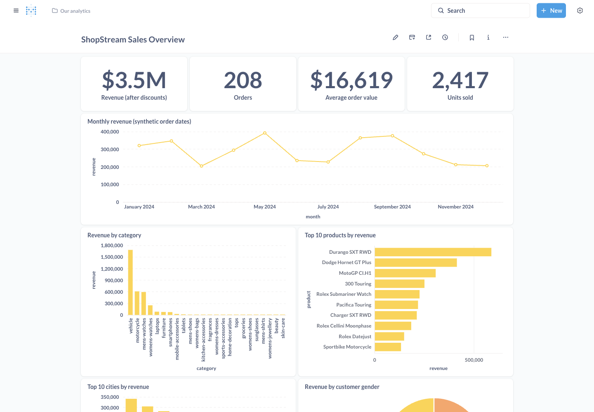
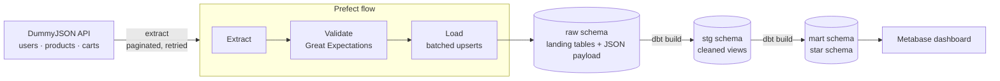
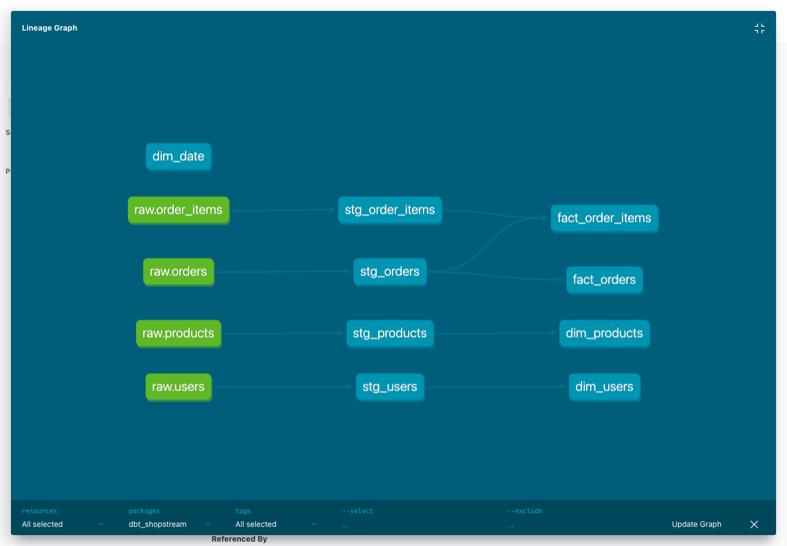
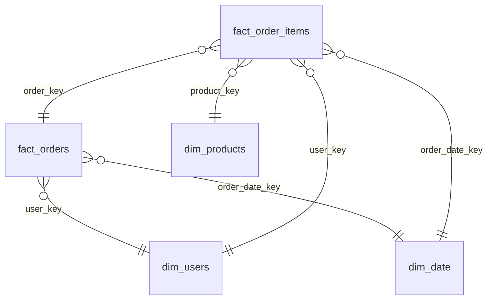
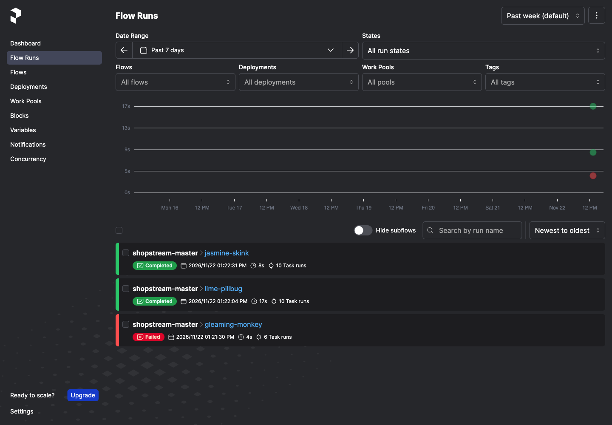

# ShopStream DE

An end-to-end batch ELT pipeline that runs entirely on your machine with Docker.
It pulls e-commerce data (users, products, orders) from the public
[DummyJSON](https://dummyjson.com) API, validates it, loads it into Postgres, models it
into a star schema with dbt, and serves a ready-made dashboard in Metabase.



## Architecture



| Layer | Tool | What happens |
|---|---|---|
| Orchestration | Prefect 2 (+ UI) | Extracts run concurrently with retries; validation gates loading; dbt runs last |
| Data quality | Great Expectations | Checks run on extracted data **before** load (row counts, null/unique ids, value ranges, compound keys) |
| Storage | PostgreSQL 15 | `raw` → `stg` → `mart` schemas |
| Transformation | dbt Core | Sources, staging views, star schema tables, 33 data tests, lineage docs |
| BI | Metabase | Dashboard built automatically through the Metabase API |
| Infra | Docker Compose | One command brings up all four services |

## Data model





- **fact_orders**: one row per order (gross total, discounted total, discount, product and unit counts)
- **fact_order_items**: one row per product in an order
- **dim_users**, **dim_products**, **dim_date**

## Quickstart

Requires Docker.

```bash
cp .env.example .env    # set a password
make demo               # start services, run the pipeline, build the dashboard
```

| Service | URL |
|---|---|
| Metabase dashboard | http://localhost:3000 (login from `MB_ADMIN_EMAIL` / `MB_ADMIN_PASSWORD` in `.env`) |
| Prefect UI (flow runs, task logs) | http://localhost:4200 |
| dbt docs + lineage graph | `make docs`, then http://localhost:8081 |
| Postgres | `make psql`, or `localhost:5437` from any SQL client |

## Commands

```bash
make up         # build and start services
make ingest     # run the pipeline: extract → validate → load → dbt build
make dbt        # dbt models and tests only
make test       # Python unit tests
make dashboard  # (re)build the Metabase dashboard
make docs       # dbt docs and lineage graph on :8081
make psql       # SQL shell (try the queries in sql/demo_queries.sql)
make down       # stop services, keep data
make clean      # stop services and delete all data
```

## Design decisions

- **Idempotent loads.** Raw tables are upserted on the source id, and order items are replaced
  per order. Re-running the pipeline never creates duplicates, and dbt `unique` tests guard this.
- **Validate before loading.** If the API returns bad data, the flow fails before anything is
  written and dbt never runs on it. This caught a real source quirk on the first run: 12 carts list
  the same product on two lines. A plain upsert would have silently dropped one line's revenue, so
  the loader now merges duplicate lines, and order totals reconcile with item totals to the cent.

  
- **Raw keeps everything.** Each raw row stores the full source record as `JSONB`, so new
  fields can be modelled later without re-extracting.
- **Synthetic order dates are flagged.** DummyJSON carts have no date. Rather than stamping
  orders with the run date (which shifts every run), `stg_orders` derives a stable date from the
  order id and sets `order_date_is_synthetic = true`.
- **One set of credentials.** dbt falls back to the `POSTGRES_*` variables, so `.env` stays small.

## Project structure

```
├── orchestration/flows/   Prefect flow and tasks
├── pipelines/
│   ├── extract/           DummyJSON pagination client
│   ├── load/              record → row mapping and batched upserts
│   └── quality/           Great Expectations checks
├── dbt_shopstream/
│   ├── models/staging/    sources + cleaned views (stg)
│   ├── models/marts/      star schema (mart)
│   ├── macros/            schema naming
│   └── tests/generic/     custom generic tests
├── scripts/               Metabase dashboard provisioning
├── tests/                 pytest unit tests
├── sql/                   demo queries
└── infra/                 Dockerfile, Postgres init scripts
```

## What I'd do next at scale

- Incremental dbt models keyed on `ingested_at` instead of full rebuilds
- CI that runs `pytest` and `dbt build` against a throwaway Postgres on every PR
- Schedule the flow with a Prefect deployment, and add failure alerts
- Swap Postgres for a cloud warehouse (BigQuery, Snowflake) via a second dbt target
